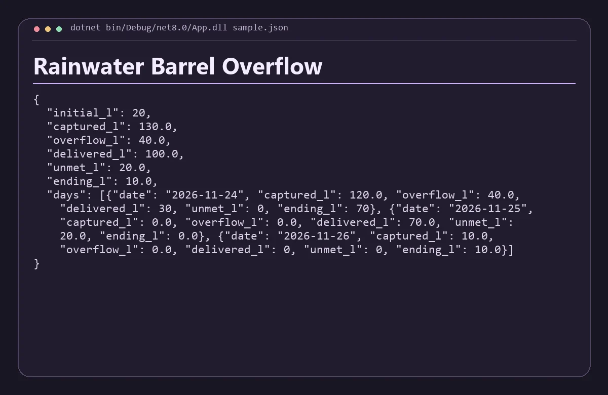

# Rainwater Barrel Overflow

Model daily roof capture, barrel overflow, and requested water use to compare storage capacity with a given rainfall record.



## Run

Install .NET 8 SDK and runtime. Run these commands from the repository root.

```sh
dotnet build --nologo
dotnet bin/Debug/net8.0/App.dll sample.json
```

Replace `sample.json` with a JSON file following the same structure. The app prints a JSON report to standard output.

Supply one row per modeled date using YYYY-MM-DD, rainfall in millimetres, and planned use in litres. Catchment is rain_mm multiplied by roof area in square metres and efficiency from 0 to 1. Each dated row captures rain and spills excess before supplying demand from storage. Storage carries across rows, including gaps between dates.

## Verify

Run `python check.py` with Python 3.11 or newer after the build step when applicable. The check verifies the bundled scenario and confirms that an invalid input returns an error.
